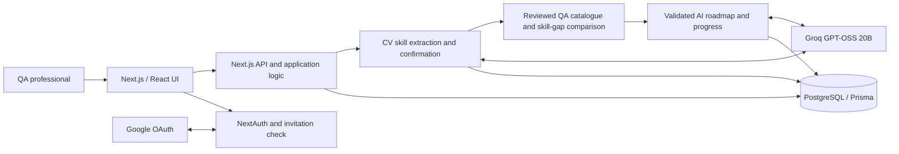

# QA Pathway — AI-Powered QA Upskilling Application

**IT6070 — Emerging Topics in Information Technology | Assignment 02**  
**Status:** Local academic prototype using synthetic inputs  
**Source code:** [GitHub development branch](https://github.com/Aravin7/ai_powered_qa-upskilling-app/tree/codex/retire-live-legacy-roadmap)

## 1. Project overview

QA Pathway helps experienced Quality Assurance (QA) professionals identify learning gaps in AI-assisted testing and build realistic learning roadmaps.

The system connects two implemented features:

1. **AI-assisted skill extraction:** The learner optionally uploads a synthetic PDF CV, reviews the prepared text, receives Groq-generated skill suggestions, and explicitly confirms which skills to save. Manual skill entry is supported.
2. **Personalized learning roadmap:** Confirmed skills are compared with a selected, reviewed QA direction. Groq schedules catalogue-backed learning activities into weeks based on the learner's available time. The server validates the plan before saving it, and the learner tracks progress.

**Emerging technology:** Generative AI through the Groq API, using `openai/gpt-oss-20b`. Skill-gap comparison and roadmap validation are **server-side rules**, not AI-generated assessments.

## 2. Implemented features and architecture

- Invitation-only Google sign-in in the local authenticated pilot; **no username/password registration**.
- Optional PDF CV text preparation and review before external AI processing.
- AI skill suggestions, explicit confirmation, and manual skill management.
- QA direction suggestions, reviewed-direction selection, and rule-based skill-gap analysis.
- AI roadmap scheduling using a compact response of **activity IDs and week assignments**; full task details come from the server-owned reviewed catalogue.
- Learning resources, practical activities, progress tracking, and saved plans.
- Development-only synthetic demo at `/demo`, without Google sign-in or Groq.

**Architecture:** A **Next.js modular monolith** with React/TypeScript frontend, Next.js server-side API routes, Google OAuth through NextAuth, Groq as the external AI provider, and PostgreSQL through Prisma.



The tested local application runs at **`http://localhost:3000`**. HTTPS production hosting has not been demonstrated.

## 3. Software requirements

| Software/service | Requirement |
| --- | --- |
| Node.js and npm | **Node.js 24**, `.nvmrc` specifies 24.19.0 |
| Operating system | Windows, macOS, or Linux with compatible Node.js |
| Database | PostgreSQL; included `compose.yaml` uses **PostgreSQL 17.6** |
| ORM | Prisma (installed via npm dependencies) |
| Docker and Docker Compose | Optional, for the provided local PostgreSQL setup |
| Browser | Current Chrome, Edge, or similar modern browser |
| Authentication | Google OAuth web-application credentials and invited account (local pilot) |
| Live AI | Groq Free Plan API key, approved local workflow, and request allowance |

Dependencies are pinned in `package.json` and `package-lock.json`.

## 4. Quick start — synthetic demo (no login)

For an assessor who wants to inspect the interface without configuring a database, Google OAuth, or Groq:

```bash
npm ci
npm run dev
```

Open **http://localhost:3000/demo**.

This is a **mock demo** using synthetic browser-local state. It does not make real Groq requests or demonstrate authenticated PostgreSQL persistence. The `/demo` route is unavailable in production builds.

## 5. Installation — authenticated local application

### 5.1 Install dependencies and start the database

From the repository directory:

```bash
npm ci
docker compose up -d db
```

Docker is optional if you already have a compatible local PostgreSQL database. The credentials in `compose.yaml` are **for isolated local development only**.

### 5.2 Configure `.env`

On Windows PowerShell:

```powershell
Copy-Item .env.example .env
```

On macOS/Linux use `cp .env.example .env`. Edit the ignored `.env` file as follows:

| Variable | Purpose |
| --- | --- |
| `DATABASE_URL` | Connection to the application PostgreSQL database |
| `DIRECT_DATABASE_URL` | Direct database connection for Prisma migrations |
| `NEXTAUTH_URL` | `http://localhost:3000` for local testing |
| `NEXTAUTH_SECRET` | Strong random authentication secret |
| `GOOGLE_CLIENT_ID` | Google OAuth client ID |
| `GOOGLE_CLIENT_SECRET` | Google OAuth client secret |
| `ENABLE_SYNTHETIC_PILOT` | Set `true` for the local invited-user pilot |
| `AI_SIGNING_SECRET` | Separate random secret of at least 32 characters |
| `AI_MODE` | `mock` or `groq` |
| `AI_BUDGET_ID` | Local request-allowance identifier |
| `GROQ_API_KEY` | Groq API key, server-side only |
| `GROQ_FREE_PLAN_CONFIRMED` | Set `true` only if you verified your account is on the Free Plan |

Do not commit populated `.env` files, keys, or local approval metadata.

### 5.3 Configure Google sign-in and invite a user

1. Create Google OAuth **Web application** credentials in Google Cloud Console.
2. Add the authorized callback URL `http://localhost:3000/api/auth/callback/google`.
3. Add your Google account as a test user, if required by the Google OAuth configuration.
4. Fill the Google client ID/secret in `.env`, with `ENABLE_SYNTHETIC_PILOT=true`.
5. Run:

```bash
npm run db:deploy
npm run db:invite -- your-google-email@example.com
npm run dev
```

Open **http://localhost:3000**, choose **Continue with Google**, and sign in with the **invited Google account**. Use the same `localhost` hostname specified in `NEXTAUTH_URL`.

### 5.4 Choose the AI processing mode

**Mock mode (no Groq key):** Set `AI_MODE=mock`, `AI_BUDGET_ID=local-mock-v1`, and a valid `AI_SIGNING_SECRET`. Then run:

```bash
npm run ai:configure-mock
npm run dev
```

Mock responses are for development checks only.

**Groq mode (local synthetic pilot):** Check your Groq account is on the Free Plan. Configure your private `.env` with:

```dotenv
AI_MODE=groq
AI_BUDGET_ID=local-groq-demo-v1
GROQ_API_KEY=YOUR_PRIVATE_KEY
GROQ_FREE_PLAN_CONFIRMED=true
ENABLE_SYNTHETIC_PILOT=true
```

Keep the database, Google OAuth, and `AI_SIGNING_SECRET` values configured. Create the local Groq request allowance:

```bash
npm run ai:configure-groq
```

**Additional requirements for live reviewed-direction roadmaps:**

- The operator must provide **genuinely approved** workflow/privacy metadata using the `--workflow-config` option of `ai:configure-groq`. Store that approval JSON **outside the repository**. Do not copy synthetic fixtures as real approvals. Re-enable relevant consent after changes to the approved notice.
- A **reviewed, activated requirement snapshot** must exist in PostgreSQL. The source-code draft (`src/lib/requirement-draft.ts`) is not automatically published when a fresh database is created. An API key alone does not activate the reviewed roadmap workflow.
- The configured allowance may expire or run out. The setup script does **not** reset existing counters. Do not change an existing budget ID unnecessarily.

Restart `npm run dev` after changing `.env`. The full live Groq setup depends on operator authorization and is **not guaranteed to work directly from a fresh clone**. See [docs/GROQ-DEMO.md](docs/GROQ-DEMO.md) for background configuration notes; some sections there describe earlier workflows.

## 6. How to use the authenticated application

1. Sign in with an invited Google account at `http://localhost:3000`.
2. Set up the profile and weekly learning availability.
3. Enable the needed consent under **Privacy & settings**.
4. Under **My skills**, optionally upload a **synthetic PDF CV**, review the minimized preview, get AI skill suggestions, and explicitly confirm skills. Manual entry is also available.
5. Under **Explore directions**, save preferences, select a reviewed QA direction, and inspect the rule-based skill-gap comparison.
6. Under **Learning roadmap**, generate a personalized schedule. Groq chooses activity IDs and weeks; the server validates and builds the full plan using catalogue content.
7. Mark an activity complete and refresh to confirm saved progress. Existing plans and progress are preserved on a failed replacement.

Learning references come from the active QA capability catalogue. The application does **not** independently verify every link's availability or relevance for a generated plan.

## 7. Sample login details

**Not applicable:** QA Pathway has no sample username/password or public sign-up. It uses **Google OAuth** with an invitation record for the Google email. A real invited account is needed for the authenticated local pilot; there is no assessor bypass.

For a login-free tour, use the development-only synthetic demo: **http://localhost:3000/demo**.

## 8. Testing and verification

General checks:

```bash
npm run typecheck
npm test
npm run build
```

Additional checks:

```bash
npm run lint
npm run test:e2e
```

The PostgreSQL integration suite **must** use a separate, migrated disposable database set through `TEST_DATABASE_URL`. Never point destructive test fixtures at an existing application database.

```bash
npm run test:integration
```

At the latest reported compact-roadmap-v2 verification, TypeScript and build passed, **282/282 unit tests** and **135/135 isolated PostgreSQL integration tests** passed. Those tests use mocked or intercepted provider responses. Separately, manual local testing showed successful live Groq skill extraction and a **4-week, 10-activity, 520-minute roadmap**, with activity completion and refresh persistence. These are scenario-specific results, not guarantees for every direction or prompt.

See [docs/BUILD-STATUS.md](docs/BUILD-STATUS.md) for historical implementation and test evidence.

## 9. Known limitations

- **Local academic pilot:** Real-user production admission is disabled; public hosting, HTTPS deployment, scaling, and operational monitoring are not verified.
- **Synthetic inputs only:** CV text minimization is imperfect. PDF inputs have size/page limits; scanned-image OCR is not supported. Never upload a real personal CV to this pilot.
- **AI reliability:** Groq can return invalid or rejected responses. The compact roadmap v2 output reduces reproduction errors but does not guarantee reliable or accurate AI results.
- **Self-reported skills:** Users explicitly confirm skill suggestions. The application does not independently certify skills or learning outcomes.
- **External resources:** Catalogue-linked pages may change, disappear, or require additional learning time. They are not independently checked for every roadmap.
- **Fresh-install dependencies:** Live reviewed-direction planning requires an operator-approved workflow and an activated reviewed content snapshot; setting a Groq key is insufficient.
- **Quotas and costs:** Local request ceilings, provider rate limits, and the Groq Free Plan constraints apply. App-level request counters are not billing guarantees.
- **Synthetic `/demo`:** It uses browser-local mock state and does not verify real Google OAuth, Groq, or PostgreSQL interactions.
- **Adoption:** Professional content quality, broad usability, backup/recovery, and real-world production readiness still need further evaluation.

## 10. Repository structure

| Location | Purpose |
| --- | --- |
| `src/app/` | Next.js pages and API routes |
| `src/components/` | Interface, CV upload, and learner workspace |
| `src/lib/auth.ts` | Google OAuth and local pilot sign-in rules |
| `src/lib/ai-operations.ts` | Consent, provider operations, validation, and plan persistence |
| `src/lib/groq-provider.ts` | Groq Chat Completions HTTP integration |
| `src/lib/reviewed-direction.ts` | Reviewed QA direction selection and gap comparison |
| `src/lib/reviewed-roadmap.ts` | Reviewed learning activities, compact schedule reconstruction, validation |
| `src/lib/store.ts` | Profile, skills, roadmap, and progress database access |
| `prisma/` | PostgreSQL schema and migrations |
| `tests/` | Unit, integration, and end-to-end tests |
| `docs/` | Build history, verification evidence, and additional technical notes |

**Source submission:** [GitHub — `codex/retire-live-legacy-roadmap`](https://github.com/Aravin7/ai_powered_qa-upskilling-app/tree/codex/retire-live-legacy-roadmap)

> **Security:** Do not commit API keys, Google client secrets, a populated `.env`, real CVs, or locally approved workflow metadata. This application is intended for a controlled academic demonstration.
